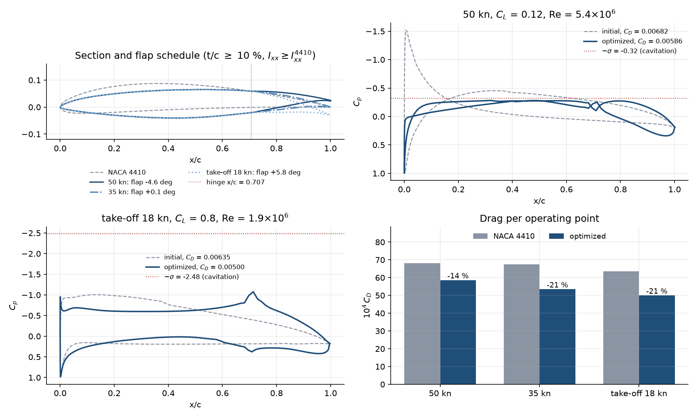
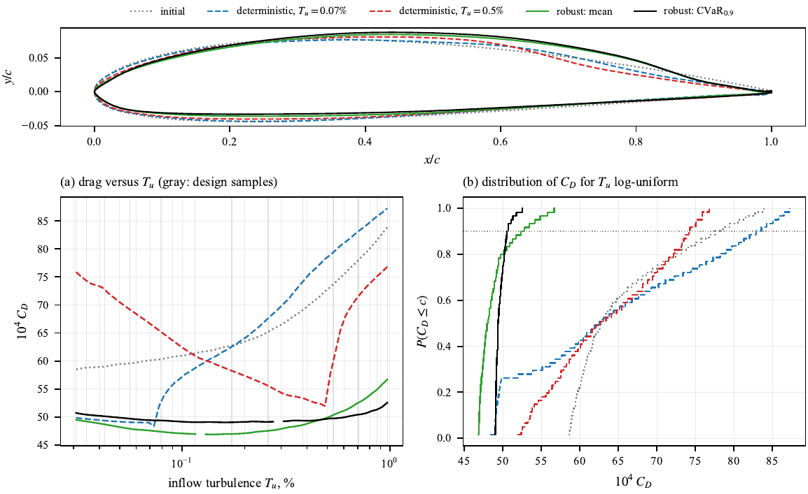
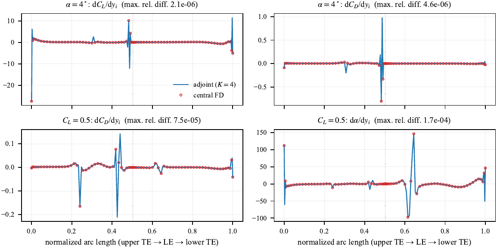

# XFOIL<sub>AD</sub> — adjoint-based section optimization with XFOIL

XFOIL<sub>AD</sub> optimizes the shape of a 2D section (hydrofoil, wing, blade) with a
gradient-based algorithm. The gradients are adjoint: the complete XFOIL
viscous–inviscid solver, e<sup>N</sup> transition model included, is
differentiated in reverse mode with [Tapenade](https://team.inria.fr/ecuador/en/tapenade/).
One gradient costs about one analysis plus one reverse sweep (3 to 4 analyses),
whatever the number of design variables.

XFOIL (its differentiated version) is compiled into a library and called
directly from Python through a ctypes interface, inside the Python process.
No executable is launched, no input file or keyboard sequence is written, no
output text file is parsed: the coordinates go in and the results (C<sub>L</sub>,
C<sub>D</sub>, C<sub>p</sub>, C<sub>f</sub>, boundary-layer state) and their
gradients come back as NumPy arrays. A call costs only the computation
itself, with no process start-up or file I/O overhead, and an analysis can
restart from a previous boundary-layer state. XFOIL<sub>AD</sub> is therefore easy to
embed in any Python workflow: an optimizer, a parametric study, or a coupling
with other tools.



*Main foil section of a 50-knot foiling catamaran (chord 0.25 m, 1 m deep,
sea water), starting from a NACA 4410. The shape, one flap deflection per speed and the
hinge position are optimized together (19 variables, exact adjoint gradients)
to minimize the weighted drag at 50 kn (C<sub>L</sub> = 0.12), 35 kn
(C<sub>L</sub> = 0.25) and take-off at 18 kn (C<sub>L</sub> = 0.8), with no
cavitation at any speed (C<sub>p,min</sub> ≥ −σ), t/c ≥ 10 %, a bending
inertia I<sub>xx</sub> at least that of the NACA 4410 (same foil stiffness,
active at the optimum), a flap thickness of at least half that of the NACA 4410
from 75 to 97 % chord, and a take-off drag at most 1.25 times the initial one.
Drag −14 % at 50 kn, −21 % at 35 kn and −21 % at take-off; hinge moved from
0.70 to 0.71 c, flap −4.6° at top speed, +0.1° at 35 kn, +5.8° at take-off;
the cavitation constraint is active at 50 kn. Best feasible design of a
300-iteration SLSQP run.*

## Features

* **Objectives**: weighted drag `Σ wᵢ·CDᵢ/CDᵢ⁰` over one or several operating
  points, each at fixed C<sub>L</sub> (α is an output) or fixed α. Also `cdp`,
  `cdf`, `cd_cl`, `ld`, `cm`, dimensional drag.
* **Flow constraints** per point: `cpmin` (KS-smoothed minimum Cp: cavitation
  inception or suction peak), `alpha`, `cl`, `cm`, `cd`, `cfmin`, `cmh` (flap
  hinge moment).
* **Geometric constraints** (exact gradients): `max_thickness`,
  `thickness(x)`, `camber(x)`, `box` (the section must contain a spar),
  `area`, `inertia`, `section_modulus`, `le_radius`, `te_angle`, `smoothness`.
* **Parametrizations**: B-splines (default, tested up to 155 variables) or CST,
  both linear in the design variables; symmetric sections.
* **Robust design**: mean or CVaR of the drag over an uncertain inflow
  turbulence level (Tu → Ncrit by Mack's correlation), over the incidence
  about the trim at fixed lift (Gauss–Lobatto quadrature), or both.
* **Trailing-edge flap**: one deflection per operating point as a design
  variable, optimized together with the shape at no extra adjoint cost; the
  hinge position x/c can be a design variable too (`hinge_var=True`).
* **Transition**: e<sup>N</sup> (Ncrit or turbulence level Tu), forced
  transition.
* **Optimizers**: SciPy SLSQP (default) or IPOPT through ctypes.
* **Tangent mode** (`XFoilTangent`) and node sensitivities (dCL/dy, dCp/dy…).
* **Parallel evaluation** of operating points in worker processes.

Architecture: the solver and its adjoint are compiled Fortran; the
parametrization, constraints and optimizer drivers are plain Python and easy
to extend.

## Installation (Windows)

The compiled libraries for 64-bit Windows (`xfoilad.dll`: analysis and
adjoint, `xfoilad_tgt.dll`: tangent mode) are distributed as a release
asset, not in the Git repository: no compiler and no build step are needed.

1. Clone the repository.
2. Download `xfoilad-win64.zip` from the
   [Releases page](https://github.com/msacher90/XFOILAD/releases) and extract
   `xfoilad.dll` and `xfoilad_tgt.dll` into `xfoilad/lib/`.
3. Then:

```bat
python -m venv venv
venv\Scripts\python.exe -m pip install -r requirements.txt
venv\Scripts\python.exe docs\guide\cases\c05_single_point.py
```

The IPOPT optimizer (`method="ipopt"`, optional) is not included: download
`Ipopt-3.14.20-win64-msvs2022-md.zip` from the
[coin-or Ipopt releases](https://github.com/coin-or/Ipopt/releases/tag/releases%2F3.14.20)
and copy the DLLs of its `bin/` folder into `xfoilad/lib/ipopt/` (or set
`XFOILAD_IPOPT_DLL` to the path of `ipopt-3.dll`).

## Python API

```python
import xfoilad as xa

param = xa.BSplineAirfoil.from_naca("2412", n_ctrl=12)        # or .from_dat("my_section.dat")
points = [xa.OperatingPoint(cl=0.3, re=8e5, weight=1.0),
          xa.OperatingPoint(cl=0.9, re=6e5, weight=0.5, ncrit=7.0)]
pb = xa.Problem(param, points, objective="cd", dv_bounds=0.04)
pb.add_constraint("cpmin", point=1, lower=-1.2)
pb.add_constraint("box", x_range=(0.15, 0.55), y_range=(-0.035, 0.045))
pb.add_constraint("inertia", axis="xx", lower=7e-5)
pb.add_constraint("max_thickness", lower=0.12)
res = xa.optimize(pb, maxiter=50)                 # or method="ipopt"
xa.write_dat("opt.dat", *param.coordinates(res.dv))
```

The same problem can be described in a JSON file and run with
`python -m xfoilad config.json` (format: user guide, "Command line and JSON file").

### Robust design under uncertain turbulence

```python
tus, p = xa.ln_uniform_samples(0.03, 1.0, 13)    # Tu log-uniform on [0.03, 1] %
pts = [xa.OperatingPoint(cl=0.5, re=1e6, tu=t) for t in tus]
pb = xa.Problem(param, pts, objective="cd")
pb.add_constraint("cpmin", point="all", lower=-1.0)
res = xa.optimize(xa.CVaRProblem(pb, p, alpha=0.9), maxiter=60)
```



*Robust design over an uncertain inflow turbulence level, starting from a
NACA 2412 (C<sub>L</sub> = 0.5, Re = 10<sup>6</sup>, C<sub>p,min</sub> ≥ −1):
Tu log-uniform on [0.03, 1] %, 13 quadrature nodes, every section checked
afterwards on 61 other Tu values. Top: sections. (a) Drag versus Tu: each
deterministic optimum (designed for Tu = 0.07 % or 0.5 %) is the best near
its design point and among the worst elsewhere, while the robust sections keep
a long laminar run at every Tu. (b) Distribution of C<sub>D</sub> (dotted:
α = 0.9); the CVaR optimum is nearly vertical.*

| 10<sup>4</sup> C<sub>D</sub> over Tu ∈ [0.03, 1] % | mean | q<sub>0.9</sub> | CVaR<sub>0.9</sub> | max |
|---|---|---|---|---|
| initial (NACA 2412) | 65.8 | 77.6 | 81.0 | 83.9 |
| deterministic, Tu = 0.07 % | 64.3 (−2 %) | 82.9 (+7 %) | 85.4 (+5 %) | 87.3 (+4 %) |
| deterministic, Tu = 0.5 % | 63.7 (−3 %) | 74.2 (−4 %) | 75.5 (−7 %) | 76.8 (−8 %) |
| robust, mean | 48.9 (−26 %) | 52.3 (−33 %) | 54.6 (−33 %) | 56.7 (−32 %) |
| robust, CVaR<sub>0.9</sub> | 49.7 (−24 %) | 50.5 (−35 %) | 51.4 (−37 %) | 52.5 (−37 %) |

### Shape and flap together

```python
pts = [xa.OperatingPoint(cl=0.3, flap=0.0, flap_var=True, name="cruise"),
       xa.OperatingPoint(cl=1.0, flap=0.0, flap_var=True, name="climb")]
pb = xa.Problem(param, pts, flap_hinge=(0.75, 0.5), flap_bounds=(-5, 15))
res = xa.optimize(pb)
print(pb.flap_angles(res.dv))
```

With `Problem(..., hinge_var=True, hinge_bounds=(0.55, 0.85))` the hinge
position x/c is the last design variable (`pb.hinge_x(res.dv)`), shared by
all the points with a flap. Its gradient is exact: it combines the motion of
the rotated nodes and of the faired-hinge ramp, the hinge height that follows
the surface, and the flap contour of the hinge moment.

### Direct calls to the solver

```python
xf = xa.XFoilAD()
xf.set_flow(re=1e6, ncrit=9.0)
x, y = xa.naca4("2412", 80)
r = xf.analyze(x, y, cl=0.5)                      # alpha, CD, Cp, Cf... as NumPy arrays
gx, gy, gcl = xf.adjoint(x, y, cl=0.5, seed={"cd": 1.0})   # dCD/dx, dCD/dy, dCD/dCL
```

## Validation

NACA 0012 at Re = 6·10<sup>6</sup> (Ladson, NASA TM 4074; Abbott & von
Doenhoff): drag within 1 % with transition tripped at 0.05 c (user guide,
"Experimental validation").

## Documentation

The user guide (`docs/user_guide.pdf`, 41 pages) covers the formulation,
gradients, parametrizations, flow conditions, constraints, flap, robust
design, the Python API, the JSON command line and troubleshooting, with
fifteen worked examples (analysis, gradients, transition, robust designs,
flap, skin friction, sensitivities). Their scripts are in `docs/guide/cases`
and the JSON files of the command line in `docs/guide/config`.

## How the adjoint works

XFOIL first converges from a cold start (not differentiated). The
Tapenade-generated reverse code then replays the geometry → panels → wake →
influence matrix chain and only K Newton iterations restarted from the
converged boundary-layer state. Since the Newton map is contracting at the
solution, the reverse sweep of these K iterations converges to the exact
discrete adjoint gradient (Christianson's reverse accumulation). On a
NACA 0012 at Re = 10<sup>6</sup> with 159 nodes, K = 3 already matches finite
differences; the default is K = 4.



*Gradients of the outputs with respect to the y coordinate of every panel
node (NACA 2412, Re = 10<sup>6</sup>, Ncrit = 9): adjoint with K = 4 (lines)
against central finite differences, h = 10<sup>−7</sup> (symbols, every other
node; dotted line: LE). Maximum difference relative to the largest component:
2.1·10<sup>−6</sup> for dC<sub>L</sub>/dy and 4.6·10<sup>−6</sup> for
dC<sub>D</sub>/dy at α = 4°, 7.5·10<sup>−5</sup> for dC<sub>D</sub>/dy and
1.7·10<sup>−4</sup> for dα/dy at fixed C<sub>L</sub> = 0.5. The sharp peaks
at the leading edge and at the transition points are captured.*

Several changes to the XFOIL sources were needed to get exact (not just
plausible) derivatives from Tapenade: pointer aliasing of the boundary-layer
station arrays, `EQUIVALENCE` work arrays, a routine shared between two
call sites with different activity, and sequence association in array
arguments. The adjoints of the linear solvers are hand-written
(`fortran/handad/`). Every gradient was checked against finite differences.

## Repository layout

```
xfoilad/        Python package (solver interface, geometry, problem, optimizers, robust design)
  lib/          compiled libraries for 64-bit Windows (xfoilad.dll, xfoilad_tgt.dll), from the release
fortran/
  src/          XFOIL sources prepared for algorithmic differentiation
  generated/    reverse-mode code produced by Tapenade
  generated_tgt/ tangent-mode code produced by Tapenade
  handad/       hand-written adjoints of the linear solvers
  api/          C API (bind(c))
  adfirstaid/   Tapenade runtime (MIT licence)
docs/           user guide (user_guide.pdf), its example cases (guide/cases),
                JSON configurations (guide/config) and README illustrations (img)
```

## Limitations

* XFOIL is a 2D viscous–inviscid method: no 3D effects, limited validity in
  massive separation.
* The e<sup>N</sup> transition position depends on the shape in a non-smooth
  way: gradients are exact for the discrete code, but the objective can have
  local optima. Try several starting points.
* When XFOIL does not converge on a trial design, the design is penalized and
  the line search backs off; spikes in the history are normal.

## Related tools

[CMPLXFOIL](https://mdolab-cmplxfoil.readthedocs-hosted.com/) (complex-step
XFOIL), [Xfoil.jl](https://flow.byu.edu/Xfoil.jl/dev/),
[mfoil](https://websites.umich.edu/~kfid/MYPUBS/Fidkowski_2023_mfoil.pdf),
[NeuralFoil](https://arxiv.org/abs/2503.16323) (learned surrogate),
XOPTFOIL (gradient-free). To our knowledge XFOIL<sub>AD</sub> is the only public tool
providing the reverse-mode adjoint of the complete XFOIL, boundary layer
included.

## Licence

GPL-3.0-or-later (see `LICENSE`). XFOIL is © Mark Drela and its Fortran 90
port © D. de Vries, both under the GPL; XFOIL<sub>AD</sub> is a derivative work.
Bundled third-party components keep their own licences: the Tapenade runtime
in `fortran/adfirstaid/` (MIT, © Inria). IPOPT (EPL-2.0, coin-or) is not
distributed with XFOIL<sub>AD</sub>.

## Citation

If you use XFOIL<sub>AD</sub> in your work, please cite it as:

```bibtex
@software{sacher2026xfoilad,
  author  = {Sacher, Matthieu},
  title   = {{XFOILAD}: adjoint-based section optimization with {XFOIL}},
  year    = {2026},
  url     = {https://github.com/msacher90/XFOILAD},
  note    = {Reverse-mode adjoint of the complete XFOIL solver, boundary layer included}
}
```

Parts of the implementation and
of the documentation were developed with AI coding assistants.
